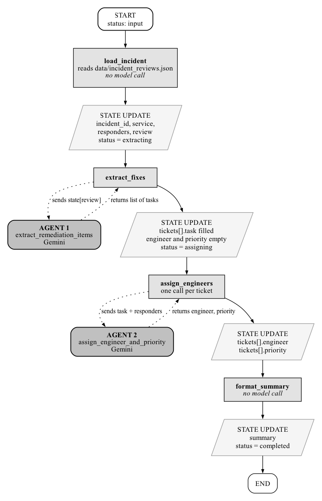
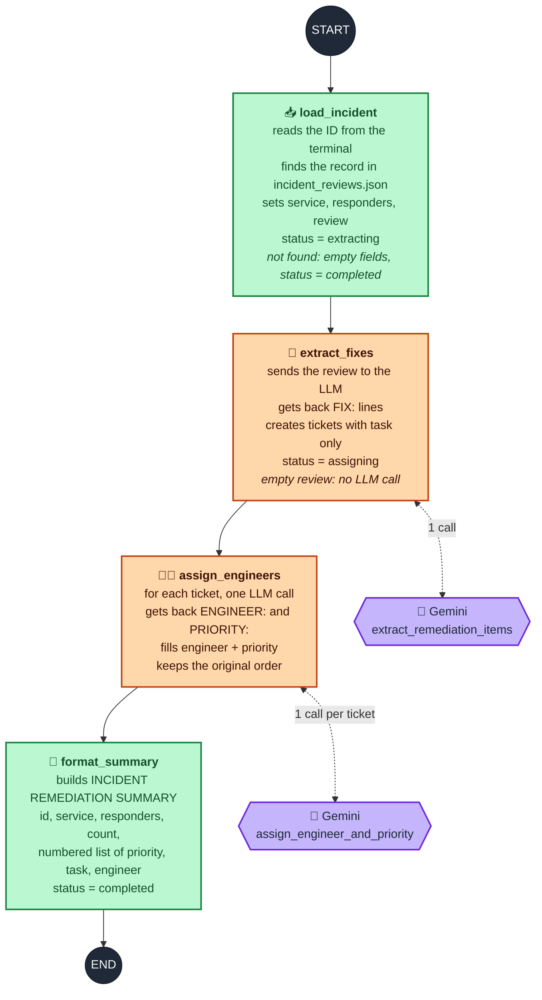
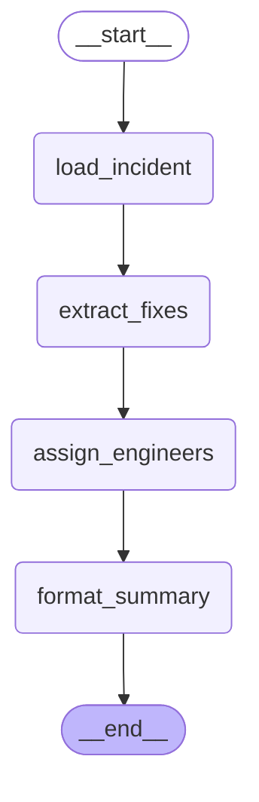

# INCIDENT REMEDIATION TICKET WORKFLOW USING LANGGRAPH

## PROBLEM STATEMENT
An online retailer holds a review after every production incident, and each review is written up as a free-text summary by the engineers who responded. The follow-up fixes agreed in the review stay buried inside the prose. Nobody is named against a fix and nothing marks which ones are urgent, so the same weaknesses often cause the next incident.

The company requires a terminal application that reads a stored incident review and produces a list of remediation tickets, each assigned to an engineer from that incident's responders and graded by priority.

---

## OBJECTIVE
Build a LangGraph workflow that loads an incident from a JSON file, uses a language model to identify the remediation fixes contained in the review, uses a language model again to assign every fix to a responder with a priority, and prints a formatted remediation summary. The information gathered at each step is carried forward through a typed LangGraph state schema.

---

## FILE STRUCTURE & PURPOSE OF FILES
* **`state.py`** — Declares the typed state schema shared by every node of the workflow.
* **`agents.py`** — Holds the two language model agents that read the review and assign the fixes.
* **`nodes.py`** — Implements the four workflow nodes that load, transform, and format the state.
* **`graph.py`** — Builds and compiles the LangGraph workflow from the nodes.
* **`main.py`** — Creates the initial state, runs the workflow, and prints the summary.
* **`tests.py`** — Contains the automated test cases that validate the implementation.
* **`requirements.txt`** — Lists the Python package dependencies required by the project.
* **`.env`** — Stores the Gemini API key and the model name as environment variables.
* **`data/incident_reviews.json`** — Incident records that serve as the input for the workflow.

---

## DATASET DESCRIPTION
The dataset is a JSON file holding six incident records under a single top-level key named `incidents`. Each record carries its review as one block of continuous prose, so the remediation fixes have to be recovered from the wording rather than read from a prepared list.

Every record has exactly four responders, each referred to somewhere in that record's review, which runs between 895 and 919 characters.

---

## MODULE EXPLANATION
The project is divided into five modules. The state module declares the schema that travels through the workflow. The agent module contains nothing but language model calls. The node module contains the workflow steps. The graph module assembles those steps into a compiled workflow, and the main module runs it.

The workflow is a straight line of four nodes: the incident is loaded, its fixes are extracted, engineers are assigned, and the summary is laid out. Every node receives the whole state and returns only the fields it has changed. LangGraph merges those fields back into the state, and appends to the conversation history through the reducer declared on the messages channel rather than overwriting it.

### Workflow Diagram
How the state changes after each node, and where the two agents are called.



### Workflow Architecture
The four nodes run strictly in sequence, with no branches and no parallel steps. Green nodes are plain Python and orange nodes call the language model.



### Compiled Graph
The graph as LangGraph reports it, from `build_workflow().get_graph().draw_mermaid()`:



---

## TASK & MODULE SPECIFICATIONS

### MODULE: `state.py`

#### State Schema Declaration
```python
class IncidentState(TypedDict):
    ...
```

#### Requirements
* Declare the state as a typed dictionary named `IncidentState`.
* Annotate the `messages` channel with the `add_messages` reducer so that node messages are appended to the history rather than replacing it.
* Declare every field listed below with the type stated against it.

#### Fields
* **`messages`** — Annotated list of messages. The running conversation history, annotated with the LangGraph `add_messages` reducer so that each node's messages are appended to the existing history rather than replacing it.
* **`incident_id`** — String. Identifier of the incident entered by the user.
* **`service`** — String. Name of the affected service and incident title.
* **`responders`** — List of strings. Names of the engineers who responded to the incident.
* **`review`** — String. Review text of the loaded incident.
* **`tickets`** — List of dictionaries. One entry per remediation fix, each holding the task text, its engineer, and its priority.
* **`summary`** — String. The finished report that is printed to the console.
* **`status`** — Literal string. The stage the workflow has reached, restricted to `input`, `extracting`, `assigning`, and `completed`.

---

### MODULE: `agents.py`

#### Agent: `extract_remediation_items`

##### Function Signature
```python
extract_remediation_items(review: str) -> list[str]
```

##### Parameters
* **`review`** (*String*): The review of one incident, supplied by the extraction node.

##### Purpose
Asks the language model which remediation fixes the incident review produced, and returns them as plain text tasks.

##### Requirements
* Send the incident review to the language model with an instruction that requests every remediation or follow-up action arising from the review.
* Require the reply to carry one action per line, each line opening with the marker `FIX:` followed by the action.
* Retain only the lines opening with `FIX:` and remove that marker from each.
* Leave the decision of what counts as a fix, and how it is worded, entirely to the model.
* Do not create, discard, reword, or default any fix in code.

##### Returns
A list of strings, one per fix the model reported.

---

#### Agent: `assign_engineer_and_priority`

##### Function Signature
```python
assign_engineer_and_priority(task: str, responders: list[str]) -> tuple[str, str]
```

##### Parameters
* **`task`** (*String*): One remediation fix, supplied by the assignment node.
* **`responders`** (*List of strings*): The responders of the incident the fix came from, supplied by the assignment node.

##### Purpose
Asks the language model which responder should carry out a single fix and how high its priority is.

##### Requirements
* Send the fix and the complete responder list to the language model in a single instruction.
* Require the model to select exactly one engineer from the responder list supplied and to copy the name as written.
* Require the priority to be one of `High`, `Medium`, or `Low`.
* Require the reply as exactly two lines, the first opening with `ENGINEER:` and the second with `PRIORITY:`, so that the two values can be read independently.
* Do not select the engineer by matching words against responder names, do not derive the priority from alarm words, and do not substitute a default when a line cannot be read.

##### Returns
A tuple of two strings holding the engineer and the priority.

---

### MODULE: `nodes.py`

#### Node: `load_incident`

##### Function Signature
```python
load_incident(state: IncidentState) -> dict
```

##### Parameters
* **`state`** (*IncidentState*): The current workflow state, supplied by LangGraph.

##### Purpose
Reads an incident identifier from the terminal and loads that incident record from the dataset.

##### Requirements
* Read the incident identifier from the terminal and discard the surrounding whitespace.
* Select the record whose identifier matches the entry.
* Copy the service, responders, and review of that record into the state unchanged, and set the status to `extracting`.
* Where the identifier matches no record, leave the service, the responder list, and the review empty, record a message naming the identifier, and set the status to `completed`.

##### Returns
A dictionary of the state fields this node has changed.

---

#### Node: `extract_fixes`

##### Function Signature
```python
extract_fixes(state: IncidentState) -> dict
```

##### Parameters
* **`state`** (*IncidentState*): The current workflow state, supplied by LangGraph.

##### Purpose
Hands the incident review to the extraction agent and records the fixes it reports.

##### Requirements
* Pass the review held in the state to the extraction agent.
* Record every task returned as one ticket holding that task, with the engineer and the priority left empty.
* Set the status to `assigning`.
* Where the state holds no review, make no model call and complete the workflow with an empty ticket list.

##### Returns
A dictionary of the state fields this node has changed.

---

#### Node: `assign_engineers`

##### Function Signature
```python
assign_engineers(state: IncidentState) -> dict
```

##### Parameters
* **`state`** (*IncidentState*): The current workflow state, supplied by LangGraph.

##### Purpose
Obtains an engineer and a priority for every ticket recorded so far.

##### Requirements
* Consult the assignment agent once for each ticket, supplying that single fix together with the responder list held in the state.
* Carry each task through unchanged alongside the engineer and priority returned for it.
* Preserve the order of the tickets.
* Do not batch several fixes into one call, and do not reuse one reply across several fixes.

##### Returns
A dictionary of the state fields this node has changed.

---

#### Node: `format_summary`

##### Function Signature
```python
format_summary(state: IncidentState) -> dict
```

##### Parameters
* **`state`** (*IncidentState*): The current workflow state, supplied by LangGraph.

##### Purpose
Lays the collected results out as the report that is shown to the user.

##### Requirements
* Open the report with a heading followed by the incident identifier, the service, and the comma-separated responder list.
* State the number of tickets found.
* List every ticket in order with its position, its priority, its task text, and its engineer.
* Store the finished report in the state and set the status to `completed`.

##### Returns
A dictionary of the state fields this node has changed.

---

### MODULE: `graph.py`

#### Function: `build_workflow`

##### Function Signature
```python
build_workflow()
```

##### Parameters
This function takes no parameters.

##### Purpose
Assembles the four nodes into a LangGraph workflow and returns it ready to run.

##### Requirements
* Create a state graph over the incident state schema.
* Register the four nodes under the names `load_incident`, `extract_fixes`, `assign_engineers`, and `format_summary`.
* Connect the start of the graph to the loading node, each node to the one that follows it in that order, and the formatting node to the end of the graph.
* Return the compiled graph.

##### Returns
The compiled LangGraph workflow.

---

### MODULE: `main.py`

#### Main Block Requirements
* Build the workflow.
* Create an initial state with an empty message history, an empty ticket list, empty text fields, and the status set to `input`.
* Run the workflow once on that initial state.
* Print the summary held in the returned state.

---

## OUTPUT FORMAT

### Generated Files
No files are generated by this program. All results are printed to the console.

### Console Output
The program prompts for an incident identifier, then prints the remediation summary: the incident identifier, the service, the responder list, the number of tickets found, and each ticket with its position, priority, task text, and engineer.

### Expected Output Example
```text
Enter incident ID: INC-301

INCIDENT REMEDIATION SUMMARY

Incident ID : INC-301
Service     : Checkout API - Payment Timeout Outage
Responders  : Ravi Menon, Claire Dubois, Tomasz Nowak, Amara Eze

Tickets (5):
  1. [High] Raise the payment client connection pool limit before the 18 April sale.
     Engineer: Ravi Menon
  2. [High] Lower the checkout latency alert threshold to match current traffic.
     Engineer: Claire Dubois
  3. [Medium] Update the payment failure runbook to point to a working dashboard.
     Engineer: Tomasz Nowak
  4. [High] Refund or manually retry the failed orders by Wednesday.
     Engineer: Amara Eze
  5. [Low] Tidy the old log retention settings next quarter.
     Engineer: Tomasz Nowak
```
*Note: The number of tickets, their wording, the engineer chosen for each, and the priority given to each are decided by the language model and will differ between runs.*

---

## IMPLEMENTATION STEPS

### Environment Setup
1. **Navigate to project directory:**
   ```bash
   cd Project
   ```
2. **Install dependencies from `requirements.txt`:**
   ```bash
   pip install -r requirements.txt
   ```
3. **Executing Solution:**
   ```bash
   python3 main.py
   ```
4. **To Run Test Cases:**
   ```bash
   python3 -m pytest tests.py -vv
   ```
