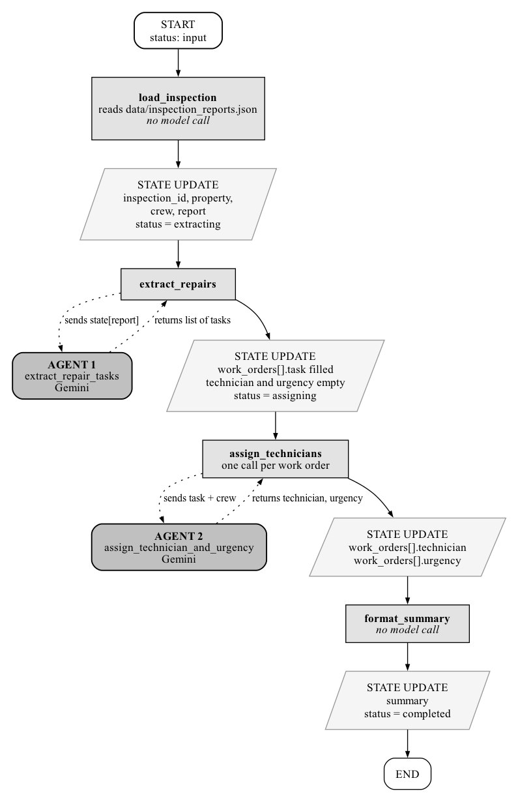
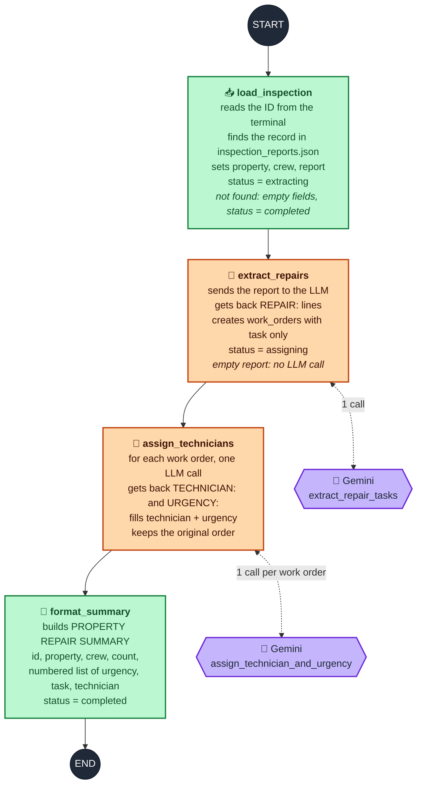
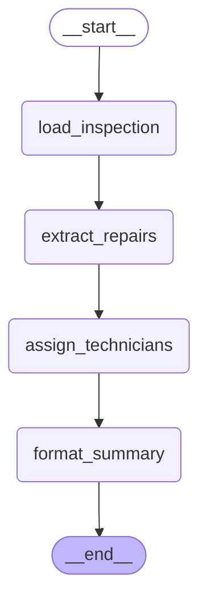

# PROPERTY REPAIR WORK ORDER WORKFLOW USING LANGGRAPH

## PROBLEM STATEMENT
A facilities management company sends a crew of technicians to inspect every property it looks after, and each visit is written up as a free-text report. The defects found during the visit stay buried inside the prose. Nobody is named against a repair and nothing marks which faults are urgent, so safety problems spotted on one visit are often still open at the next.

The company requires a terminal application that reads a stored inspection report and produces a list of work orders, each assigned to a technician from that inspection's crew and graded by urgency.

---

## OBJECTIVE
Build a LangGraph workflow that loads an inspection from a JSON file, uses a language model to identify the repair jobs contained in the report, uses a language model again to assign every job to a crew member with an urgency, and prints a formatted repair summary. The information gathered at each step is carried forward through a typed LangGraph state schema.

---

## FILE STRUCTURE & PURPOSE OF FILES
* **`state.py`** — Declares the typed state schema shared by every node of the workflow.
* **`agents.py`** — Holds the two language model agents that read the report and assign the repairs.
* **`nodes.py`** — Implements the four workflow nodes that load, transform, and format the state.
* **`graph.py`** — Builds and compiles the LangGraph workflow from the nodes.
* **`main.py`** — Creates the initial state, runs the workflow, and prints the summary.
* **`tests.py`** — Contains the automated test cases that validate the implementation.
* **`requirements.txt`** — Lists the Python package dependencies required by the project.
* **`.env`** — Stores the Gemini API key and the model name as environment variables.
* **`data/inspection_reports.json`** — Inspection records that serve as the input for the workflow.

---

## DATASET DESCRIPTION
The dataset is a JSON file holding six inspection records under a single top-level key named `inspections`. Each record carries its findings as one block of continuous prose, so the repair jobs have to be recovered from the wording rather than read from a prepared list.

Every record has exactly four crew members, each referred to somewhere in that record's report, which runs between 887 and 907 characters.

---

## MODULE EXPLANATION
The project is divided into five modules. The state module declares the schema that travels through the workflow. The agent module contains nothing but language model calls. The node module contains the workflow steps. The graph module assembles those steps into a compiled workflow, and the main module runs it.

The workflow is a straight line of four nodes: the inspection is loaded, its repairs are extracted, technicians are assigned, and the summary is laid out. Every node receives the whole state and returns only the fields it has changed. LangGraph merges those fields back into the state, and appends to the conversation history through the reducer declared on the messages channel rather than overwriting it.

### Workflow Diagram
How the state changes after each node, and where the two agents are called.



### Workflow Architecture
The four nodes run strictly in sequence, with no branches and no parallel steps. Green nodes are plain Python and orange nodes call the language model.



### Compiled Graph
The graph as LangGraph reports it, from `build_workflow().get_graph().draw_mermaid()`:



---

## TASK & MODULE SPECIFICATIONS

### MODULE: `state.py`

#### State Schema Declaration
```python
class InspectionState(TypedDict):
    ...
```

#### Requirements
* Declare the state as a typed dictionary named `InspectionState`.
* Annotate the `messages` channel with the `add_messages` reducer so that node messages are appended to the history rather than replacing it.
* Declare every field listed below with the type stated against it.

#### Fields
* **`messages`** — Annotated list of messages. The running conversation history, annotated with the LangGraph `add_messages` reducer so that each node's messages are appended to the existing history rather than replacing it.
* **`inspection_id`** — String. Identifier of the inspection entered by the user.
* **`property`** — String. Name of the inspected property.
* **`crew`** — List of strings. Names of the technicians who carried out the inspection.
* **`report`** — String. Findings of the loaded inspection.
* **`work_orders`** — List of dictionaries. One entry per repair job, each holding the task text, its technician, and its urgency.
* **`summary`** — String. The finished report that is printed to the console.
* **`status`** — Literal string. The stage the workflow has reached, restricted to `input`, `extracting`, `assigning`, and `completed`.

---

### MODULE: `agents.py`

#### Agent: `extract_repair_tasks`

##### Function Signature
```python
extract_repair_tasks(report: str) -> list[str]
```

##### Parameters
* **`report`** (*String*): The findings of one inspection, supplied by the extraction node.

##### Purpose
Asks the language model which repair jobs the inspection produced, and returns them as plain text tasks.

##### Requirements
* Send the inspection report to the language model with an instruction that requests every repair or follow-up job arising from the inspection.
* Require the reply to carry one job per line, each line opening with the marker `REPAIR:` followed by the job.
* Retain only the lines opening with `REPAIR:` and remove that marker from each.
* Leave the decision of what counts as a repair, and how it is worded, entirely to the model.
* Do not create, discard, reword, or default any repair in code.

##### Returns
A list of strings, one per repair the model reported.

---

#### Agent: `assign_technician_and_urgency`

##### Function Signature
```python
assign_technician_and_urgency(task: str, crew: list[str]) -> tuple[str, str]
```

##### Parameters
* **`task`** (*String*): One repair job, supplied by the assignment node.
* **`crew`** (*List of strings*): The crew of the inspection the job came from, supplied by the assignment node.

##### Purpose
Asks the language model which crew member should carry out a single repair and how urgent it is.

##### Requirements
* Send the repair and the complete crew list to the language model in a single instruction.
* Require the model to select exactly one technician from the crew list supplied and to copy the name as written.
* Require the urgency to be one of `High`, `Medium`, or `Low`.
* Require the reply as exactly two lines, the first opening with `TECHNICIAN:` and the second with `URGENCY:`, so that the two values can be read independently.
* Do not select the technician by matching words against crew names, do not derive the urgency from alarm words, and do not substitute a default when a line cannot be read.

##### Returns
A tuple of two strings holding the technician and the urgency.

---

### MODULE: `nodes.py`

#### Node: `load_inspection`

##### Function Signature
```python
load_inspection(state: InspectionState) -> dict
```

##### Parameters
* **`state`** (*InspectionState*): The current workflow state, supplied by LangGraph.

##### Purpose
Reads an inspection identifier from the terminal and loads that inspection record from the dataset.

##### Requirements
* Read the inspection identifier from the terminal and discard the surrounding whitespace.
* Select the record whose identifier matches the entry.
* Copy the property, crew, and report of that record into the state unchanged, and set the status to `extracting`.
* Where the identifier matches no record, leave the property, the crew list, and the report empty, record a message naming the identifier, and set the status to `completed`.

##### Returns
A dictionary of the state fields this node has changed.

---

#### Node: `extract_repairs`

##### Function Signature
```python
extract_repairs(state: InspectionState) -> dict
```

##### Parameters
* **`state`** (*InspectionState*): The current workflow state, supplied by LangGraph.

##### Purpose
Hands the inspection report to the extraction agent and records the repairs it reports.

##### Requirements
* Pass the report held in the state to the extraction agent.
* Record every task returned as one work order holding that task, with the technician and the urgency left empty.
* Set the status to `assigning`.
* Where the state holds no report, make no model call and complete the workflow with an empty work order list.

##### Returns
A dictionary of the state fields this node has changed.

---

#### Node: `assign_technicians`

##### Function Signature
```python
assign_technicians(state: InspectionState) -> dict
```

##### Parameters
* **`state`** (*InspectionState*): The current workflow state, supplied by LangGraph.

##### Purpose
Obtains a technician and an urgency for every work order recorded so far.

##### Requirements
* Consult the assignment agent once for each work order, supplying that single repair together with the crew list held in the state.
* Carry each task through unchanged alongside the technician and urgency returned for it.
* Preserve the order of the work orders.
* Do not batch several repairs into one call, and do not reuse one reply across several repairs.

##### Returns
A dictionary of the state fields this node has changed.

---

#### Node: `format_summary`

##### Function Signature
```python
format_summary(state: InspectionState) -> dict
```

##### Parameters
* **`state`** (*InspectionState*): The current workflow state, supplied by LangGraph.

##### Purpose
Lays the collected results out as the report that is shown to the user.

##### Requirements
* Open the report with a heading followed by the inspection identifier, the property, and the comma-separated crew list.
* State the number of work orders found.
* List every work order in order with its position, its urgency, its task text, and its technician.
* Store the finished report in the state and set the status to `completed`.

##### Returns
A dictionary of the state fields this node has changed.

---

### MODULE: `graph.py`

#### Function: `build_workflow`

##### Function Signature
```python
build_workflow()
```

##### Parameters
This function takes no parameters.

##### Purpose
Assembles the four nodes into a LangGraph workflow and returns it ready to run.

##### Requirements
* Create a state graph over the inspection state schema.
* Register the four nodes under the names `load_inspection`, `extract_repairs`, `assign_technicians`, and `format_summary`.
* Connect the start of the graph to the loading node, each node to the one that follows it in that order, and the formatting node to the end of the graph.
* Return the compiled graph.

##### Returns
The compiled LangGraph workflow.

---

### MODULE: `main.py`

#### Main Block Requirements
* Build the workflow.
* Create an initial state with an empty message history, an empty work order list, empty text fields, and the status set to `input`.
* Run the workflow once on that initial state.
* Print the summary held in the returned state.

---

## OUTPUT FORMAT

### Generated Files
No files are generated by this program. All results are printed to the console.

### Console Output
The program prompts for an inspection identifier, then prints the repair summary: the inspection identifier, the property, the crew list, the number of work orders found, and each work order with its position, urgency, task text, and technician.

### Expected Output Example
```text
Enter inspection ID: INS-201

PROPERTY REPAIR SUMMARY

Inspection ID : INS-201
Property      : Harbourview Apartments - Block A Quarterly Inspection
Crew          : Leila Haddad, Connor Walsh, Arjun Pillai, Beatriz Souza

Work Orders (5):
  1. [High] Reseal the lifted roof membrane above flats 9 and 10.
     Technician: Leila Haddad
  2. [High] Repair the failed emergency lighting in the north stairwell.
     Technician: Connor Walsh
  3. [Medium] Investigate the overnight pressure drop on the plant room boiler.
     Technician: Arjun Pillai
  4. [Medium] Fix the communal entrance door closer.
     Technician: Beatriz Souza
  5. [High] Renew the annual gas safety certificate before 20 March.
     Technician: Arjun Pillai
```
*Note: The number of work orders, their wording, the technician chosen for each, and the urgency given to each are decided by the language model and will differ between runs.*

---

## IMPLEMENTATION STEPS

### Environment Setup
1. **Navigate to project directory:**
   ```bash
   cd Project
   ```
2. **Install dependencies from `requirements.txt`:**
   ```bash
   pip install -r requirements.txt
   ```
3. **Executing Solution:**
   ```bash
   python3 main.py
   ```
4. **To Run Test Cases:**
   ```bash
   python3 -m pytest tests.py -vv
   ```
